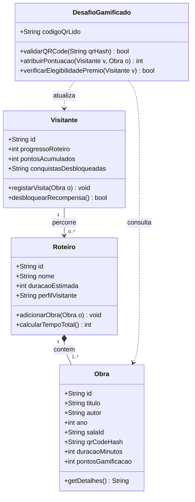
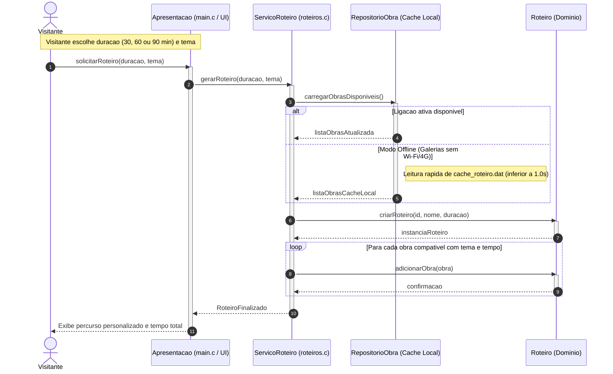
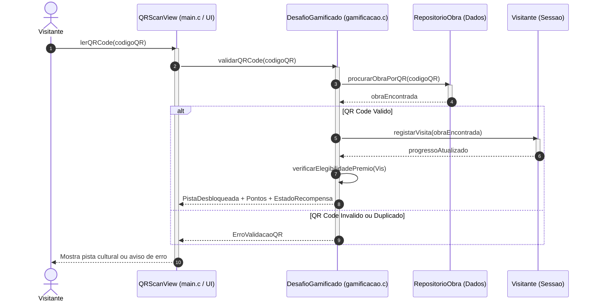

# Arquitetura do Sistema — App MNSR Digital (Marco M2)

**Equipa:** 17 | **Repositório:** `app-mnsr-digital` | **Sessão:** 4 (Arquitetura & Modelação UML)

---

## 1. Parametrização de Roteiros e Cache
* **Tempo máximo de roteiro configurado:** 90 minutos (suporte completo para visitas de 30, 60 e 90 min)
* **Ficheiro de persistência offline:** `cache_roteiro.dat`
* **Módulos principais:** `main.c`, `roteiros.c`, `gamificacao.c`, `assistente.c`

---

## 2. Arquitetura em 3 Camadas (Separação de Responsabilidades)

O sistema adota o padrão arquitetural em **3 Camadas** (*Layered Architecture*), assegurando **alta coesão**, **baixo acoplamento** e dependência estritamente unidirecional de cima para baixo:

| Camada Arquitetural | Responsabilidade Principal | Componentes Conceptuais (REST/App) | Mapeamento no Código C (MVP) |
| :--- | :--- | :--- | :--- |
| **1. Apresentação (UI / Controller)** | Captura de entradas do visitante, validação de formato e apresentação de resultados, sem regras de negócio nem acesso direto a ficheiros. | `VisaoRoteiro`, `RoteiroController`, `QRScanView` | `main.c` (menus CLI, leitura de inputs e formatação de saída) |
| **2. Lógica de Negócio (Domain / Service)** | Algoritmos de seleção de roteiros por tempo/tema, validação de QR Codes, cálculo de pontos/recompensas e filtro anti-alucinação RAG. | `ServicoRoteiro`, `DesafioGamificado`, `AssistenteService` | `roteiros.c`, `gamificacao.c`, `assistente.c` |
| **3. Persistência (Repository / Dados)** | Armazenamento e recuperação local de obras, fichas curatoriais e estado da sessão, garantindo resiliência *offline-first* (`< 1,0s`). | `RepositorioObra`, `RepositorioVisita`, `BaseDadosLocal` | Catálogo estruturado em memória e persistência binária (`cache_roteiro.dat`) |

---

## 3. Diagrama de Classes UML (Visão Estrutural — Mermaid.js)

O diagrama seguinte representa as entidades centrais do domínio do Museu Nacional Soares dos Reis, os seus atributos, operações e relações estruturais:

---

## 4. Diagramas de Sequência UML (Visão Dinâmica — Mermaid.js)

### 4.1 US-01: Geração de Roteiro Inteligente com Resiliência Offline

### 4.2 US-02: Validação de QR Code na Caça ao Tesouro

